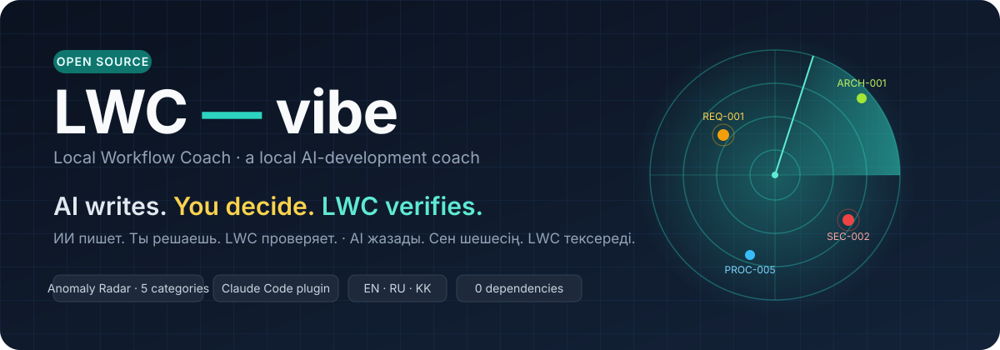
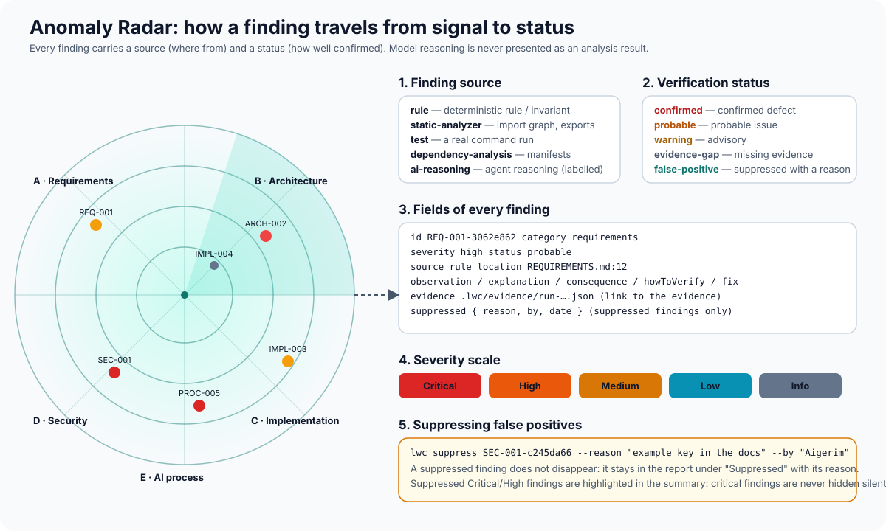
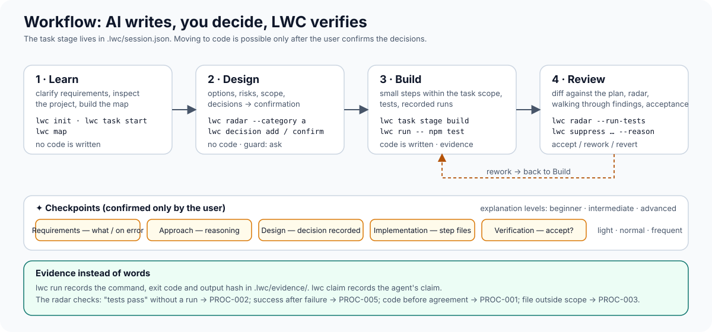

<div align="center">



# LWC — vibe

**Local Workflow Coach · a local AI-development coach with Anomaly Radar**

*AI writes. You decide. LWC verifies.*

[](https://github.com/RuslanKazyradzi13/lwc-vibe/actions/workflows/ci.yml)
[](LICENSE)
[](package.json)
[](package.json)
[](docs/KAZAKHSTAN.md)
[](docs/LWC%20-%20vibe.pdf)

[Install](#install) · [First run](#first-run) · [Evidence Gate](#evidence-gate) · [Anomaly Radar](#anomaly-radar) · [PDF documentation](docs/LWC%20-%20vibe.pdf) · [Русский](README.ru.md) · [Қазақша](README.kk.md)

</div>

> **Status: prototype 0.2.0.** Everything described below is implemented and covered by tests, but
> this is not a production-grade product. The limitations are listed honestly in [Limitations](#limitations).

## The problem

An AI agent can write an application in an evening that its author cannot explain, let alone verify.
Typical consequences: code is written before the requirements are agreed; "tests pass" is said but the
tests never ran; files nobody asked for are changed; a database key ends up in the code; two
requirements contradict each other and the implementation silently picks one.

LWC — vibe helps you use AI to write software **without losing understanding of the system and
control over the result**: the agent clarifies requirements first, shows a plan, discusses risks,
gets explicit confirmation for significant decisions, implements small changes and verifies the
result. Anomaly Radar then checks the agent's words against facts.

## How it differs from VibeWise

The project is inspired by the approach of [VibeWise](https://github.com/nykooi1/vibe-wise)
(Noah Kim, MIT) — "learn while AI writes the code" — but it is an independent implementation with a
different architecture. Detailed reference analysis: [docs/REFERENCE_ANALYSIS.md](docs/REFERENCE_ANALYSIS.md).

| | VibeWise | LWC — vibe |
| --- | --- | --- |
| Control over code before agreement | an instruction in a Markdown skill | a task stage in `.lwc/session.json`, the CLI gate `lwc task stage build`, a Claude Code hook that **asks** when code is edited too early, rule PROC-001 |
| "Tests pass" | the agent's words | `lwc run` records the real run (exit code, output hash); claims are checked against evidence (PROC-002, PROC-005) |
| Checking requirements, architecture, code, security | none | **Anomaly Radar**: 5 categories, 29 rules, a status and a source on every finding |
| Operational data | none | `lwc ops-check` — report checks with configurable rules, example in KZT |
| Languages | English | English, Russian, Kazakh (full catalogs, translated READMEs) |
| Hooks | Python | Node.js, the same runtime as Claude Code |
| Works without an agent | no | yes: a CLI for the terminal and CI |

## Features

- **Seven modes** for Claude Code: `learn`, `design`, `build`, `review`, `explain`, `radar`,
  `resume` — [skills/](skills/). The shared process is described in [docs/PROCESS.md](docs/PROCESS.md).
- **Three explanation levels**: beginner, intermediate, advanced — [skills/learn/levels.md](skills/learn/levels.md).
  The user may say "skip the explanation", "fewer checkpoints", "more on X"; important architectural
  decisions and dangerous changes are always confirmed.
- **Checkpoints** and decisions confirmed only by the user (`lwc decision confirm`).
- **Evidence instead of words**: `lwc run -- npm test` records the run in `.lwc/evidence/` together
  with a fingerprint of the code it ran on.
- **Evidence Gate** (`lwc gate`): is the task really done? Agent claims are checked against recorded
  runs on the *current* code; the verdict is PASS / INSUFFICIENT EVIDENCE / FAIL — see below.
- **Optional Nace Drex advisory** for the gate: off by default, needs only an environment variable,
  sends a minimal redacted payload and can never change the verdict — [docs/NACE.md](docs/NACE.md).
- **Anomaly Radar** — see below. Reports as text / Markdown / JSON, `--fail-on` for CI.
- **Operational report checks** (`lwc ops-check`) with an explanation for every finding.
- **Local context** in `.lwc/`: no server, telemetry or cloud.
- **Zero runtime dependencies.** Node.js ≥ 20. TypeScript, ESM.

## Evidence Gate

An agent says "done, tests pass". `lwc gate` checks whether the recorded facts support that **for
the code as it is now**:

- every `lwc run` stores a fingerprint of the working tree, so a test run made before the latest edit
  is reported as **stale**, not as proof;
- each claim is matched to the evidence it needs: tests/build/lint/completion need a passing run of
  that kind; security and requirement claims are marked as **not verifiable automatically** instead
  of being believed;
- five checks (tests, claims, Critical/High findings, decisions, analyzer health) give the verdict
  **PASS**, **INSUFFICIENT EVIDENCE** or **FAIL**, with exit codes for CI (`--fail-on`);
- the report keeps three sections apart — *confirmed by deterministic checks*, *not confirmed yet*,
  *AI advisory (not evidence)* — and records what the result rests on (rule-set digest, config
  digest, git HEAD, working-tree digest, evidence ids).

```bash
lwc run -- npm test
lwc claim add "Implemented, tests pass"
lwc gate                      # PASS while the code is unchanged since the run
# …one more edit without rerunning the tests…
lwc gate                      # INSUFFICIENT EVIDENCE: the run is stale, claim C1 is not backed
lwc gate --ai nace            # optional: Nace Drex triage of findings, shown as advisory only
```

Full description: [docs/EVIDENCE_GATE.md](docs/EVIDENCE_GATE.md). Nace setup, the exact data sent and
the remaining manual checks: [docs/NACE.md](docs/NACE.md).

## Anomaly Radar



The radar looks for anomalies in five categories and states honestly **where** each finding came
from and **how well** it is confirmed.

| Category | Rules | Examples |
| --- | --- | --- |
| A. Requirements | REQ-000…005 | two requirements contradict each other; error behaviour is undefined; "fast and intuitive" cannot be verified; a business rule is missing from the acceptance criteria |
| B. Architecture | ARCH-001…005 | cyclic imports; a declared module boundary is violated; documentation describes a non-existent directory; an export was removed but dependents were not updated |
| C. Implementation | IMPL-001…007 | `JSON.parse` without `try`; an empty `catch`; `i <= arr.length`; assignment in `if`; a module without tests; a **real test run** (`--run-tests`); dead exports; duplicates |
| D. Security | SEC-001…006 | secrets in code; SQL/shell injection, `eval`, XSS; a route without authorisation, disabled TLS; a path from `req.query` into `fs`; `git+https` and `*` dependencies; `permissions: write-all` |
| E. AI-development process | PROC-001…005 | code before agreement; "verified" without a run; a file outside the task scope; changes without tests; success claimed after a failed check |

Statuses: **confirmed defect**, **probable issue**, **warning**, **evidence gap**, **false positive**
(suppressed with a reason). Sources: rule, static analysis, test run, dependency analysis, AI agent
reasoning. Scale: Critical, High, Medium, Low, Info. Full reference: [docs/RULES.md](docs/RULES.md).
Report format: [docs/REPORT_FORMAT.md](docs/REPORT_FORMAT.md).

False positives are suppressed **only with a reason** and stay in the report in a separate section;
suppressed Critical/High findings are highlighted in the summary. In code, the markers `lwc-ignore`
(line) and `lwc-ignore-file` (file) work and are visible in diffs.

## Architecture


A dependency-free local CLI (`bin/lwc.js` → `dist/`) plus a Claude Code plugin (skills and hooks) on
top of it. State is JSON and Markdown in `.lwc/`. Details, the analyzer interface, error handling and
limitations: [docs/ARCHITECTURE.md](docs/ARCHITECTURE.md).

## Workflow example



```bash
lwc init --lang en --level beginner          # settings and .lwc/
lwc task start "Staff discount 20 %" --scope "src/services/**,tests/**"
lwc decision add "The discount is a separate function in discount.js"
lwc task stage build                          # refuses: decision D1 is not confirmed
lwc decision confirm D1                       # only a human confirms
lwc task stage build                          # now code may be written
lwc run -- npm test                           # the run is recorded in .lwc/evidence/
lwc claim add "Implemented, tests pass"       # the claim is checked against the record
lwc radar --run-tests --format md --out .lwc/reports/review.md
lwc task finish
```

In Claude Code the same steps go through the modes `/lwc-vibe:learn` → `design` → `build` → `review`;
the agent calls the CLI itself, and the `guard.mjs` hook asks for confirmation if the agent tries to
edit sources before the `build` stage.

## Example of a detected anomaly

A fragment of the real output of `node bin/lwc.js radar examples/demo-buggy-app` (a demo project
with deliberate defects, [description](examples/demo-buggy-app/README.md)):

```text
■ [Critical] PROC-005-5114eb44  Success claimed although the check failed
    Observation: The last run of `node --test tests/` exited with code 1, yet claim
                 "Implemented, tests pass" was made afterwards
    Status: confirmed defect · Source: rule · Evidence: .lwc/evidence/run-20261019123000-a1b2c3.json
    Recommended fix: Fix the problem and rerun the check before claiming success.

▲ [High] REQ-001-3062e862  Contradiction between requirements
    Where: REQUIREMENTS.md:12
    Observation: Requirement "Скидка по карте лояльности должна применяться ко всем позициям заказа."
                 contradicts requirement "Скидка по карте лояльности не должна применяться к позициям
                 со специальной ценой. (line 13)"
    Status: probable issue · Source: rule

■ [Critical] SEC-002-1e2575ac  Unsafe handling of user input
    Where: src/api/server.js:22
    Observation: SQL query built by concatenation/template:
                 `const rows = query("SELECT * FROM orders WHERE customer = '" + req.query.name + "'");`
    Status: probable issue · Source: rule
```


The full list of expected demo findings: [examples/demo-buggy-app/EXPECTED_FINDINGS.md](examples/demo-buggy-app/EXPECTED_FINDINGS.md)
(verified by a test). The operational report demo in KZT: [examples/ops-report/](examples/ops-report/README.md).

## Install

Requires [Node.js](https://nodejs.org/) 20 or newer. Git — for category E rules and `ARCH-005`.

**As a Claude Code plugin** (inside a Claude Code session, one command at a time):

```text
/plugin marketplace add RuslanKazyradzi13/lwc-vibe
```

```text
/plugin install lwc-vibe@lwc-vibe
```

Restart Claude Code in your project. The CLI inside the plugin is available as
`node "${CLAUDE_PLUGIN_ROOT}/bin/lwc.js"`; install it globally for convenience (below).

**As a CLI** (terminal, CI):

```bash
npm install -g github:RuslanKazyradzi13/lwc-vibe
```

or from a clone:

```bash
git clone https://github.com/RuslanKazyradzi13/lwc-vibe.git && cd lwc-vibe && npm install && npm link
```

Check: `lwc --version` → `0.1.0`. Without installing: `node bin/lwc.js --help` from the clone.

## First run

```bash
cd my-project
lwc init --lang en --level intermediate       # creates .lwc/, detects the test command
lwc radar                                     # the first report on the project
lwc radar --category d --format md --out radar-security.md
```

In Claude Code: `/lwc-vibe:learn` — the agent reads [docs/PROCESS.md](docs/PROCESS.md), runs
`lwc resume` and starts by clarifying requirements. If `.lwc/` is missing, it offers `lwc init`.

To try the demo project with defects straight from the clone:

```bash
npm run radar:demo
npm run ops:demo
```

## Usage example

Checking a daily operational report (synthetic data, ₸):

```bash
lwc ops-check examples/ops-report/daily_report.csv \
  --rules examples/ops-report/rules.json \
  --history examples/ops-report/history.csv
```

```text
[High] OPS-003-9ca7592b Total does not match the sum of parts
    Observation: Row 6: "revenue_kzt" = 1 210 000 ₸, sum of cash_kzt + card_kzt = 1 160 000 ₸ (difference 50 000 ₸)
    Status: confirmed defect · Source: rule
[Medium] OPS-006-388a48a3 Sharp spike relative to history
    Observation: "revenue_kzt (sum)" = 28 402 000 ₸, median of 7 previous periods = 8 360 000 ₸ (ratio 3.40, threshold ×2.5)
    Status: probable issue · Source: rule
```

The same report in Kazakh: add `--lang kk`; in Russian: `--lang ru`. Explain a module from its real
relations: `lwc explain src/services/orders.js`. Context for the agent: `lwc resume`. In CI:
`lwc radar --fail-on high` returns exit code 1 on High/Critical findings, and
`lwc gate --format md --fail-on fail` produces a PR-sized evidence report.

## Configuration

Two layers: `lwc.config.json` in the project root (in Git, shared by the team) and `.lwc/config.json`
(personal, created by `lwc init`). Fields:

```json
{
  "lang": "en",
  "level": "intermediate",
  "checkpoints": "normal",
  "testCommand": "npm test",
  "guard": "ask",
  "ignore": ["generated/**"],
  "rules": { "IMPL-004": false },
  "boundaries": [{ "from": "src/ui/**", "deny": ["src/db/**"], "note": "UI never talks to the DB directly" }],
  "thresholds": { "maxFanOut": 12, "duplicateMinLines": 8 },
  "requirementFiles": ["docs/REQUIREMENTS.md"],
  "architectureDocs": ["docs/ARCHITECTURE.md"],
  "gate": { "requireTests": "auto" },
  "ai": { "provider": "off", "maxFindings": 40, "includePaths": true, "nace": { "model": "drex-latest", "apiKeyEnv": "NACE_API_KEY" } }
}
```

API keys are never read from config files: `lwc gate` refuses to run if a config layer contains a
key such as `apiKey` or `token`. All `ai` options: [docs/NACE.md](docs/NACE.md#settings).

Rules for operational reports are a separate JSON ([example](examples/ops-report/rules.json)).
Adapting to an organisation and the Kazakhstan context: [docs/KAZAKHSTAN.md](docs/KAZAKHSTAN.md).

## Security and privacy

- Everything runs locally. No telemetry, accounts or paid backend. The only network call LWC can
  make is the optional Nace advisory, and only when you enable it (`--ai nace` or `ai.provider`) and
  set `NACE_API_KEY`. `lwc gate --ai-preview` prints the exact payload without sending it: finding
  metadata and claim texts, redacted, never source code or command output
  ([docs/NACE.md](docs/NACE.md#exactly-what-is-sent)).
- An AI answer never counts as evidence: the gate verdict is computed before the provider is called
  and the advisory section cannot change it. "Nace found no risk" is never reported as secure.
- Commands are executed only on explicit request: `lwc run -- …` and `lwc radar --run-tests`.
- Hooks never block the session on error; the guard hook **asks** by default rather than blocking
  (`guard: ask | deny | off`).
- `.lwc/` files contain fragments of your code and command output — treat them as project working
  files; add `.lwc/` to `.gitignore` if you do not want to commit them (LWC never edits `.gitignore`).
- The radar checks for secrets in code but does not replace SAST or an audit. No findings is not
  proof of no bugs.
- Reporting a vulnerability: [SECURITY.md](SECURITY.md).

## Testing

```bash
npm install
npm test            # build + 75 tests (node:test)
npm run lint        # tsc --noEmit + prettier --check
npm run check:dist  # dist/ is up to date with src/
```

Coverage: unit tests (glob, import graph, Unicode word boundaries), analyzers on synthetic projects
including false-positive and clean-project tests, process rules on temporary git repositories,
`ops-check` against [expected.json](examples/ops-report/expected.json), the CLI as a separate process
(full workflow), hooks, ru/kk/en catalog integrity, the Evidence Gate on temporary git repositories
(fresh/stale/failed runs, claims, exit codes), the Nace provider against mocked responses (missing
key, malformed key, HTTP errors, retry, timeout, network failure, malformed answers, payload privacy,
AI output never changing the verdict) without network access, the demo project against
[EXPECTED_FINDINGS.md](examples/demo-buggy-app/EXPECTED_FINDINGS.md). CI runs everything on Ubuntu and
Windows, Node 20 and 22 ([.github/workflows/ci.yml](.github/workflows/ci.yml)).

## Limitations

- Category A, C and D rules are regular-expression heuristics, not AST analysis: misses and false
  positives are possible. The finding status reflects this; completeness is not claimed.
- Code is analysed for JavaScript/TypeScript and Python; other languages — secrets and configuration only.
- The import graph does not know path aliases (`tsconfig paths`), monorepo packages or dynamic strings.
- Category E rules and ARCH-005 require Git and runs through `lwc run`.
- Only the Claude Code integration is tested; other agents are not claimed.
- The Nace integration is built from the official API reference and tested against mocked responses
  only; a real call has not been made yet ([what to check](docs/NACE.md#what-still-needs-a-manual-check)).
- Claim classification is keyword-based (en/ru/kk); unusual wording may be reported as informational.
- Run freshness needs git; without it, freshness is reported as unknown.
- No assessment of compliance with the legislation of Kazakhstan or any other country.
- The Kazakh texts were written by the authors, not reviewed by native editors; corrections are welcome.

## License

[MIT](LICENSE) © 2026 Ruslan Kazyradzi. Written from scratch; VibeWise (MIT, Noah Kim) was not
copied — see [THIRD_PARTY_NOTICES.md](THIRD_PARTY_NOTICES.md) and
[docs/REFERENCE_ANALYSIS.md](docs/REFERENCE_ANALYSIS.md).

## Roadmap

- [ ] Evidence Gate as a GitHub Action posting the Markdown report to pull requests.
- [ ] Gate history per task and per agent (`.lwc/reports/gate-*.json` is already versioned).
- [ ] Nace Perception for extracting acceptance criteria from requirement documents (PDF/DOCX).
- [ ] AST analyzers for JS/TS (the TypeScript Compiler API is already a devDependency) — fewer false positives.
- [ ] A PostToolUse hook that records test runs from Bash into `.lwc/evidence/` automatically.
- [ ] Path aliases and monorepos in the import graph.
- [ ] SARIF export for GitHub Code Scanning.
- [ ] Skills for other agents on top of the same CLI (after real testing).
- [ ] Editorial review of the Kazakh catalog by native speakers.

## Contributing and feedback

Issues and pull requests are welcome: [CONTRIBUTING.md](CONTRIBUTING.md),
[CODE_OF_CONDUCT.md](CODE_OF_CONDUCT.md). Especially useful: false-positive examples (with a minimal
reproduction), new rules with tests, translations, reports on how the plugin behaves in Claude Code.
