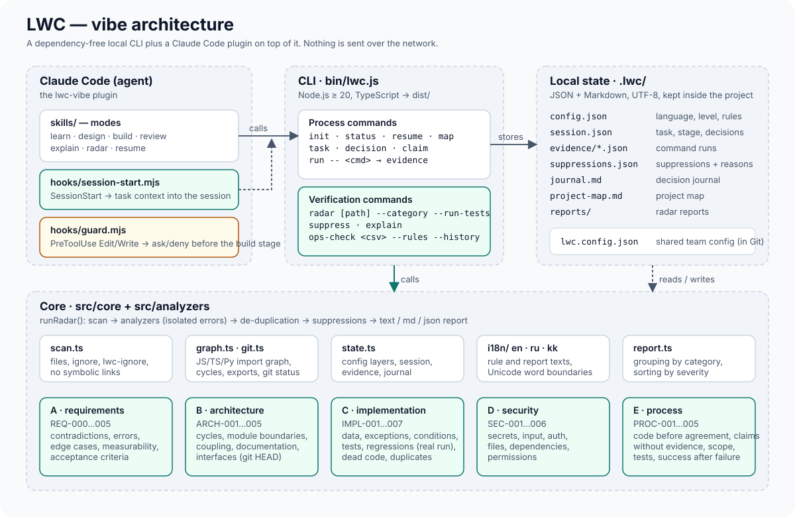

# LWC — vibe architecture



## Product format and why

Three options were considered: (1) a Claude Code plugin with Markdown skills only, like the
reference; (2) a separate service / web application; (3) **a dependency-free local CLI with a
Claude Code plugin on top**. The third one was chosen:

- Skills without an executable part cannot *verify* anything — they only ask the model to behave.
  Anomaly Radar needs real code: an import graph, test runs, comparison with `git status`.
- A service contradicts the requirements of locality and no paid backend.
- The CLI works without Claude Code (in a terminal, in CI), and the plugin adds modes, hooks and
  context restoration. Support for other agents (Codex, Cursor) reduces to their skill/hook format on
  top of the same CLI — it is **not implemented and not claimed** in this version.

## Directory layout

```text
lwc-vibe/
├── bin/lwc.js                CLI entry point (imports dist/)
├── src/                      TypeScript, ESM, strict
│   ├── cli/                  argument parsing and commands
│   │   ├── args.ts
│   │   ├── main.ts
│   │   └── commands/{session,radar}.ts
│   ├── core/
│   │   ├── findings.ts       Finding/Analyzer/LwcConfig types, severity, ids
│   │   ├── radar.ts          orchestrator: scan → analyzers → suppressions → report
│   │   ├── report.ts         text / md / json rendering
│   │   ├── state.ts          the .lwc/ directory: config, session, evidence, suppressions, journal
│   │   ├── scan.ts           file walk, filters, lwc-ignore
│   │   ├── graph.ts          JS/TS/Python import graph, cycles (Tarjan), exports
│   │   ├── git.ts            git status / git show HEAD:file
│   │   ├── glob.ts           glob → RegExp without dependencies
│   │   └── text.ts           Unicode word boundaries for Cyrillic
│   ├── analyzers/            A–E: requirements, architecture, implementation, security, process, tests-runner
│   ├── ops/opscheck.ts       operational report checks (CSV/JSON + JSON rules)
│   ├── i18n/{ru,kk,en}.ts    rule and UI text catalogs
│   └── index.ts              public API
├── dist/                     built JS (committed so the plugin and CLI work without a build step)
├── hooks/                    Claude Code hooks: session-start.mjs, guard.mjs, hooks.json
├── skills/                   modes: learn, design, build, review, explain, radar, resume
├── .claude-plugin/           plugin.json, marketplace.json
├── examples/                 demo-buggy-app (deliberate defects), ops-report (operational report)
├── tests/                    node:test, run against dist/
├── docs/                     documentation and the PDF
└── assets/                   SVG illustrations
```

## Components

| Component | Responsibility | Depends on |
| --- | --- | --- |
| CLI (`cli/`) | commands `init/status/task/decision/claim/run/radar/suppress/explain/map/resume/ops-check`, exit codes | core, analyzers, ops, i18n |
| State (`core/state.ts`) | reading/writing `.lwc/`, config layering `DEFAULT ← lwc.config.json ← .lwc/config.json` | fs |
| Radar (`core/radar.ts`) | analysis context, running analyzers with error isolation, de-duplication, suppressions, summary | scan, state, analyzers |
| Analyzers | one per category; pure functions from `AnalyzerContext` to `Finding[]` | scan, graph, git, state, i18n |
| Report | deterministic rendering; grouping by category, sorting by severity | i18n |
| Ops | CSV/JSON parsing, rules, explanations | i18n |
| Hooks | Claude Code integration; never break the session (error → silence) | dist/core/state |
| Skills | agent behaviour per mode; reference `docs/PROCESS.md` | CLI |

All modules have **no runtime dependencies**. Dev dependencies: `typescript`, `prettier`,
`@types/node`.

## Analyzer interface

```ts
interface Analyzer {
  id: string;
  category: 'requirements' | 'architecture' | 'implementation' | 'security' | 'process' | 'ops';
  run(ctx: AnalyzerContext): Finding[] | Promise<Finding[]>;
}

interface AnalyzerContext {
  root: string;                         // project root
  files: string[];                      // relative paths, already filtered by ignore
  read(rel: string): string | null;     // cached reader, null for binary/unreadable files
  lang: 'ru' | 'kk' | 'en';
  config: LwcConfig;
  allowRunCommands: boolean;            // true only with --run-tests
  log(msg: string): void;
}
```

Rule: an analyzer does not throw (the orchestrator turns exceptions into an info-level `RADAR-ERR`
finding and the other analyzers keep running). An analyzer does not execute commands unless
`allowRunCommands` is true. Findings are created through `mk()`, which guarantees that all fields are
filled from the i18n catalog and that the id is stable.

## Finding format

See [REPORT_FORMAT.md](REPORT_FORMAT.md). Key point: `id` = `<RULE>-<fnv1a(file|line|vars)>` — stable
between runs and independent of the report language, so a specific finding can be suppressed by id.

## Context storage format (`.lwc/`)

| File | Format | Content |
| --- | --- | --- |
| `config.json` | JSON | `lang`, `level`, `checkpoints`, `testCommand`, `ignore[]`, `boundaries[]`, `thresholds{}`, `rules{}`, `requirementFiles[]`, `architectureDocs[]`, `guard` |
| `session.json` | JSON | `task: {id, title, startedAt, stage, scope[], decisions[{id,text,proposedAt,confirmedAt?,confirmedBy?}], claims[{id,text,at,evidence?}], baselineChanged[]}`, `history[]` |
| `journal.md` | Markdown | `## <heading>` entries with timestamps: initialisation, decisions, stages, runs, reports, suppressions |
| `project-map.md` | Markdown | map: purpose, structure, most depended-on modules, boundaries, unknowns |
| `evidence/<id>.json` | JSON | `command, cwd, startedAt, durationMs, exitCode, stdoutTail, stderrTail, outputSha256, kind` |
| `suppressions.json` | JSON | `[{match:{id?|rule?,file?}, reason, by?, date}]` |
| `reports/radar-<ts>.json` | JSON | full radar report |

`lwc.config.json` in the project root is the same JSON as `config.json`, but kept in Git and shared by
the team (organisation rules, boundaries, thresholds). The personal `.lwc/config.json` is layered on top.

## Error handling

- CLI: any unhandled error → message on stderr, exit code 1; invalid arguments → exit code 2;
  `radar --fail-on <level>` → exit code 1 when findings at that level or above exist; `run` propagates
  the command's exit code.
- State files are read defensively: corrupted JSON ≡ missing (for session/suppressions) with defaults
  preserved; symbolic links to state files are ignored.
- Binary files and files > 2 MB are not read; symbolic links in the tree are not followed.
- Hooks: any error → exit 0 with no output (the Claude Code session is never blocked).

## Tests

`npm test` = build + `node --test` over `tests/*.test.mjs` (49 tests): unit tests (glob, graph,
text), analyzers on synthetic projects in temporary directories (including false-positive and
clean-project tests), process rules on temporary git repositories, ops-check against an expected
result, the CLI as a separate process (full workflow), hooks, i18n catalog integrity, the demo project
against `EXPECTED_FINDINGS.md`.

## Installation and updates

See the README: install as a Claude Code plugin (marketplace from GitHub) or as a CLI
(`npm install -g` from a clone/archive). Update with `claude plugin marketplace update lwc-vibe` +
`claude plugin update`, or `git pull` in the clone. `dist/` is committed and CI checks it is up to date
(`npm run check:dist`).

## Limitations

- Category A, C and D rules are regex heuristics, not a full parser/AST: misses and false positives
  are possible; the finding status reflects this honestly.
- The import graph ignores path aliases (`tsconfig paths`), dynamic strings and monorepo packages.
- IMPL-005 and PROC-* rely on `git` and on checks being run through `lwc run`.
- JS/TS and Python are supported for code; other languages — secrets/configuration only.
- Only the Claude Code integration is tested (SessionStart/PreToolUse hooks). Other agents are not claimed.
- No assessment of legal compliance: the radar knows no law.
