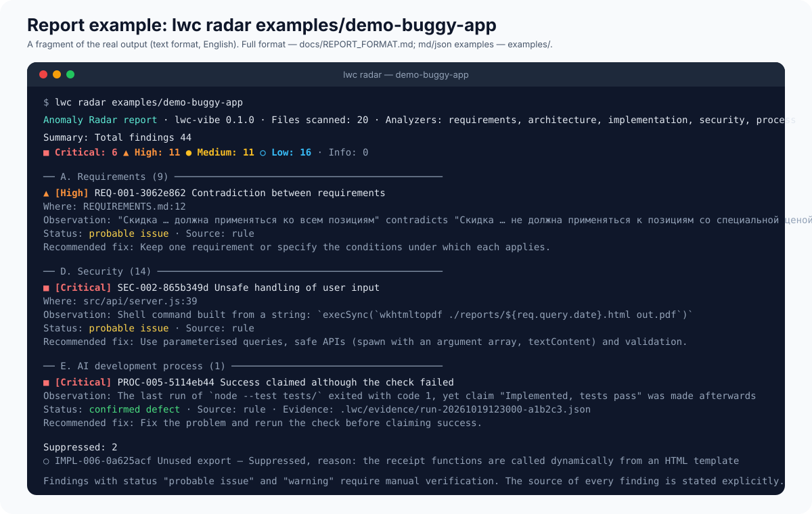

# Anomaly Radar report format



The report is available in three formats: `text` (terminal), `md` (Markdown for PRs/wikis) and
`json` (machine processing). All three are built from the same `RadarReport` structure.

## JSON

```json
{
  "tool": "lwc-vibe",
  "version": "0.1.0",
  "generatedAt": "2026-10-19T12:00:00.000Z",
  "root": "/path/to/project",
  "lang": "en",
  "filesScanned": 42,
  "analyzers": ["requirements", "architecture", "implementation", "security", "process", "tests-runner"],
  "findings": [ { "...": "see below" } ],
  "suppressed": [ { "...": "findings with status=false-positive and suppressed.reason" } ],
  "summary": {
    "total": 12,
    "bySeverity": { "critical": 1, "high": 3, "medium": 5, "low": 3 },
    "byCategory": { "security": 4, "implementation": 6, "process": 2 },
    "byStatus": { "confirmed": 3, "probable": 6, "warning": 2, "evidence-gap": 1 },
    "suppressed": 1,
    "suppressedCriticalOrHigh": 0
  },
  "log": ["requirements: 1 file(s), 3 findings", "..."]
}
```

## Finding

| Field | Type | Purpose |
| --- | --- | --- |
| `id` | `RULE-xxxxxxxx` | unique stable identifier (FNV-1a of file, line and key data; language-independent) |
| `rule` | `REQ-001` … `OPS-008` | rule identifier |
| `category` | `requirements \| architecture \| implementation \| security \| process \| ops` | category |
| `severity` | `critical \| high \| medium \| low \| info` | severity |
| `status` | `confirmed \| probable \| warning \| evidence-gap \| false-positive` | verification status |
| `source` | `rule \| static-analyzer \| test \| dependency-analysis \| ai-reasoning` | where the finding came from |
| `location` | `{file, line?, column?}` | file and line when known |
| `title` | string | short title |
| `observation` | string | the factual observation (quote/value) |
| `explanation` | string | plain-language explanation |
| `consequence` | string | possible consequence |
| `howToVerify` | string | how to reproduce or verify |
| `fix` | string | recommended fix |
| `evidence` | string? | link to a test / `.lwc/evidence/…` record |
| `suppressed` | `{reason, by?, date?}`? | suppression reason (only in `suppressed[]`) |
| `data` | object? | machine data (cycle, import list, stderr tail) |

## Severity scale

| Level | Meaning | Example |
| --- | --- | --- |
| Critical | exploitable vulnerability, data loss, a false "success" after a failure | AWS key in code, SQL injection, PROC-005 |
| High | the bug will almost certainly show, or an agreement is broken | a 3+ module cycle, `i <= length`, code before agreement |
| Medium | a probable bug or a gap that needs a decision | JSON.parse without try, total ≠ sum of parts |
| Low | quality, maintenance, weak heuristics | loose `==`, unused export |
| Info | information needing no action | requirements file not found, analyzer error |

## Suppressions

`.lwc/suppressions.json` is an array of `{ match: { id? | rule?, file? }, reason, by?, date }`.
Suppressed findings are not deleted: they go to `suppressed[]` with status `false-positive` and the
reason, and the summary counts suppressed Critical/High separately. In the text and Markdown reports
this is a separate section with a warning. An empty `match` suppresses nothing.

## Exit codes

`lwc radar` returns 0 when the report was produced; with `--fail-on <severity>` it returns 1 when
findings at that level or above exist (for CI). Invalid arguments — 2.
